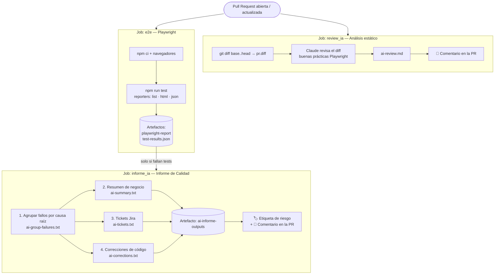

# Demo-Playwright

Suite E2E con **Playwright + TypeScript** sobre [saucedemo.com](https://www.saucedemo.com), integrada en un **pipeline de QA con IA** en GitHub Actions: cada Pull Request recibe una revisión estática del diff hecha por Claude y, si los tests fallan, un informe de calidad con resumen de negocio, borradores de tickets y propuestas de corrección.

## Qué resuelve

En un flujo de PR habitual, el revisor tiene que leer el diff de los tests, abrir el reporte de Playwright, entender por qué falló cada test y decidir si es un bug de la aplicación o del propio test. Este repositorio automatiza esa parte:

- **Revisión de buenas prácticas antes del merge.** Claude lee solo el diff de la PR y señala selectores frágiles, esperas estáticas, assertions débiles, patrones de flakiness y código repetido que debería ir a fixtures.
- **Triage automático de fallos.** Cuando la ejecución E2E falla, los resultados se agrupan por causa raíz y se clasifica el riesgo (`high` / `medium` / `low`).
- **Información útil para cada rol.** Un resumen sin jerga para producto, borradores de tickets de Jira para QA y pasos de corrección concretos para desarrollo, todo en un único comentario en la PR.
- **Señal visual del riesgo.** La PR se etiqueta con `ai:critical-risk`, `ai:needs-review` o `ai:low-risk`.
- **Defectos reales documentados.** La exploración de la aplicación dejó cinco defectos confirmados (D1–D5, ver abajo) que el plan de pruebas registra en lugar de ocultarlos.

## Pipeline

Workflow: [`.github/workflows/playwright.yml`](.github/workflows/playwright.yml), se dispara en `pull_request` (`opened`, `synchronize`, `reopened`).



| Job | Cuándo corre | Salida |
| --- | --- | --- |
| `review_ia` | Siempre, en paralelo con `e2e` | Comentario «🔍 Análisis estático de código (IA)» |
| `e2e` | Siempre | `playwright-report/`, `test-results.json` (artefactos) |
| `informe_ia` | Solo si `e2e` falla | Etiqueta `ai:*` + comentario «🚨 Informe de Calidad (IA)» + artefacto `ai-informe-outputs` |

Los prompts de cada paso del informe están versionados en [`prompts/`](prompts/), así que se pueden ajustar sin tocar el workflow.

## Cómo correrlo

### En local

Requisitos: Node.js 20+.

```bash
npm ci
npx playwright install --with-deps chromium
npm test              # ejecución headless
npm run test:headed   # con navegador visible
npm run test:ui       # modo UI de Playwright
npm run report        # abre el último reporte HTML
npm run typecheck     # comprobación de tipos
```

Variables de entorno opcionales:

| Variable | Por defecto | Uso |
| --- | --- | --- |
| `BASE_URL` | `https://www.saucedemo.com` | Entorno contra el que se ejecuta |
| `STANDARD_USER` / `STANDARD_PASSWORD` | `standard_user` / `secret_sauce` | Credenciales del usuario principal |

Cada test tiene un límite de 10 s: un test más lento se considera un problema a reportar, no a «curar» subiendo el timeout.

### En GitHub Actions

1. Agregar **uno** de estos secrets en *Settings → Secrets and variables → Actions*:
   - `ANTHROPIC_API_KEY`, o
   - `CLAUDE_CODE_OAUTH_TOKEN`
2. Abrir una Pull Request contra `main`.

Sin credenciales, los pasos de IA se omiten con un aviso y el job `e2e` sigue corriendo normalmente. Las PRs desde forks o de Dependabot no reciben secrets.

## Estructura del proyecto

```
src/
  pages/        Page Objects (Login, Inventory, ProductDetail, Cart, Base)
  components/   Componentes compartidos (Header, SideMenu)
  fixtures/     Fixtures de Playwright (páginas inyectadas, sesión iniciada)
  assertions/   Assertions reutilizables del carrito
  data/         Usuarios, productos y mensajes esperados
  utils/        Lectura del carrito en localStorage
tests/
  auth/         Login (válido, bloqueado, contraseña incorrecta)
  cart/         Alta/baja, detalle de producto, página del carrito, persistencia, acceso sin sesión
specs/          Plan de pruebas (add-to-cart.plan.md)
prompts/        Prompts del informe de calidad IA
.claude/agents/ Agentes planner / generator / healer de Playwright
```

## Defectos encontrados (D1–D5)

Detectados durante la exploración con `standard_user` y documentados en [`specs/add-to-cart.plan.md`](specs/add-to-cart.plan.md).

| ID | Defecto | Impacto | Cobertura |
| --- | --- | --- | --- |
| **D1** | **Reset App State** vacía el carrito (badge y `localStorage` a `[]`), pero los botones del inventario siguen mostrando **Remove** hasta recargar la página. | La UI contradice el estado real del carrito. | Automatizado con `test.fail()` en [`cart-persistence.spec.ts`](tests/cart/cart-persistence.spec.ts) |
| **D2** | La ordenación elegida no persiste tras recargar: vuelve a «Name (A to Z)», aunque el carrito sí se mantiene. | El usuario pierde su preferencia de orden. | Documentado en el plan (3.4) |
| **D3** | El carrito persiste tras logout y nuevo login: `localStorage` no se limpia al cerrar sesión. | Puede ser intencional, pero en un equipo compartido otro usuario ve el carrito anterior. | Documentado en el plan (5.5) |
| **D4** | Un doble clic rápido sobre **Add to cart** añade y luego quita el producto: el resultado neto es que no se añade. | Hallazgo de UX: el usuario cree que añadió el producto. | Documentado en el plan (6.3) |
| **D5** | `inventory-item.html?id=99` muestra «ITEM NOT FOUND» con texto humorístico, precio `$√-1` y un botón **Add to cart** activo. | No hay manejo de error correcto para productos inexistentes. | Documentado en el plan |

Los tests de defectos conocidos usan `test.fail()`: la suite sigue en verde mientras el defecto exista, y avisa en cuanto se corrija para que se actualice el test.
